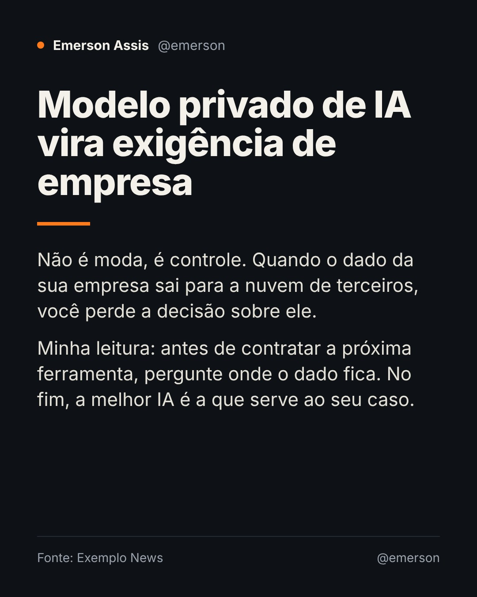

# ic-ap

Esteira local de conteúdo para Instagram: lê notícias, reage com a minha voz e contexto usando um LLM (local ou API, à sua escolha), renderiza o post (HTML → JPEG), manda para aprovação no Telegram e publica pela Instagram Graph API oficial.

> Status: app Python com painel web, pipeline completo (RSS → extração → LLM → card → aprovação → publicação), Telegram e agendador. Toda a configuração é feita no painel web (sem `.env`). **Testado ponta a ponta com serviços simulados (47 testes), ainda não contra a Meta, o Telegram, um LLM real e o Docker.**



## Subir

```bash
docker compose up -d --build
```

Abra http://localhost:8000. No primeiro acesso o app pede para **criar a senha** (e gera sozinho a chave de criptografia em `data/secret.key`; os dados ficam no volume Docker `icap_data`). Depois, tudo no painel:

1. **LLM:** rode seu LLM fora do app (LM Studio, Ollama, Jan, Gemini, Claude...). Informe tipo e endereço, clique **Detectar modelos**, escolha um e **Aplicar e testar**. Do container, use `host.docker.internal` no lugar de `localhost`.
2. **Conexões e acesso:** token do túnel Cloudflare (`docs/cloudflare-tunnel.md`), URL pública, token do bot do Telegram, fuso horário.
3. **Perfis:** dados do perfil, Telegram chat id, horários, contexto, conexão de LLM e o assistente de token da Meta. O perfil do Emerson nasce **desligado**; ligue só depois de testar tudo em **Conexões**.

Esqueceu a senha: `docker compose exec app python -m app.reset_senha`.

## O que ele faz

- **Pauta do dia:** pesquisa o que está em alta nos seus temas, cria versões com ângulos diferentes de cada notícia (feed ou Story, com print opcional da matéria). Você marca as que quer, escolhe data/hora e intervalo, e o app publica sozinho na hora marcada (a agenda é local: o app precisa estar ligado).
- **Foto e vídeo pelo Telegram:** mande uma foto ou vídeo (até 20 MB) com uma frase de contexto. O app corta para 4:5 ou 9:16, escreve a legenda no seu tom e devolve para aprovar. Palavras na legenda mudam o destino: `story`, `reel`, `feed`, `sem música`.
- **Música:** suba trilhas livres de direitos na aba Músicas; no perfil, ligue “Música nos vídeos do Telegram” e o app mixa uma faixa aleatória (a trilha fica baixa sob o áudio original).
- **Limites da API do Instagram:** sem sticker de link, enquete ou música da biblioteca do app nos Stories, sem repostar Story de terceiros e sem rascunho do próprio Instagram. Veja `docs/specs/07-midia-agenda.md`.

## Testes

```bash
cd services/app && pip install -r requirements-dev.txt && python -m pytest
```

## Specs

| Doc | Assunto |
|---|---|
| [00-viabilidade](docs/specs/00-viabilidade.md) | Veredito: o que é local, o que não é, correções ao plano original |
| [01-arquitetura](docs/specs/01-arquitetura.md) | Componentes, fluxo, estrutura de pastas, docker-compose alvo |
| [02-pipeline](docs/specs/02-pipeline.md) | Passo a passo do workflow, contrato JSON do LLM, estados do post |
| [03-instagram-publicacao](docs/specs/03-instagram-publicacao.md) | Auth, tokens, URL pública, container → publish, limites |
| [04-contexto-pessoal](docs/specs/04-contexto-pessoal.md) | Template do `meu_contexto.md` e regras de tom |
| [05-roadmap](docs/specs/05-roadmap.md) | Fases, critérios de aceite, perguntas em aberto |
| [06-dashboard-multiperfil](docs/specs/06-dashboard-multiperfil.md) | Painel web e vários perfis (Emerson, Iago, Igor) |
| [cloudflare-tunnel](docs/cloudflare-tunnel.md) | Passo a passo do túnel para a URL pública das imagens |
